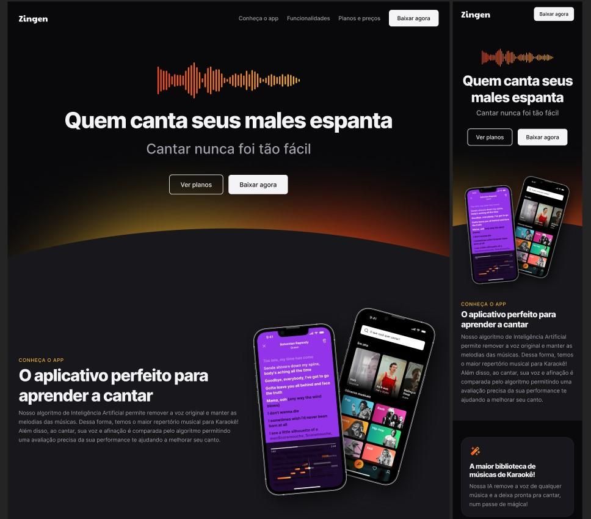

# Zingen

Landing page responsiva para o Zingen, um aplicativo de karaokê com inteligência artificial. O projeto apresenta os principais recursos do app, planos de assinatura e áreas de download para dispositivos móveis.

## Acesso ao projeto

- [Ver projeto online](https://lucas072-cpu.github.io/zingen/)

## Funcionalidades

- Layout responsivo para celulares, tablets e desktops
- Navegação por seções com rolagem suave
- Apresentação dos recursos do aplicativo
- Demonstração de interface em mockups
- Planos Básico, Premium e Família
- Área de download para Android e iOS
- Links para redes sociais e navegação no rodapé
- Identidade visual construída com gradientes e variáveis CSS

## Tecnologias utilizadas

- **HTML5** — estrutura semântica do conteúdo
- **CSS3** — estilização da interface
- **CSS Grid** — organização das seções e cards
- **Flexbox** — alinhamento e distribuição dos elementos
- **Media queries** — adaptação para telas maiores
- **CSS Custom Properties** — cores, tipografia, espaçamentos e tamanhos responsivos
- **Google Fonts / Inter** — tipografia principal
- **SVG** — ícones, logotipo e elementos gráficos
- **VS Code** — ambiente de desenvolvimento

> Este projeto foi desenvolvido apenas com HTML e CSS. Não utiliza frameworks, bibliotecas JavaScript ou ferramentas de build.

## Responsividade

A página possui um contêiner principal adaptável e usa estilos específicos a partir de telas com largura mínima de `80em`. Nesse breakpoint:

- Os elementos em coluna passam a ser exibidos lado a lado
- Recursos exclusivos para desktop são exibidos
- Tipografia e espaçamentos aumentam
- Os cards de funcionalidades recebem uma grade personalizada
